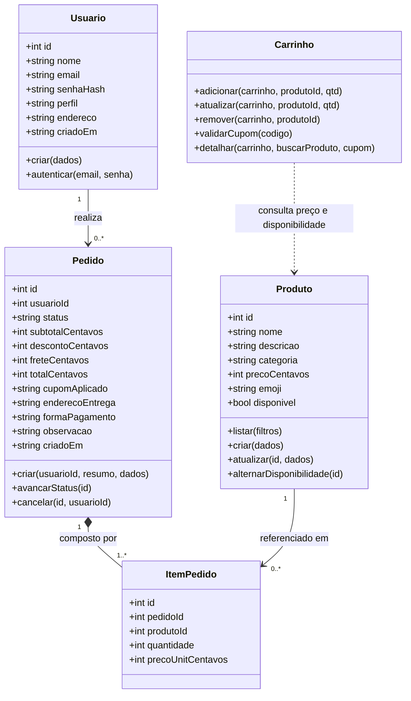

# Modelagem UML Atualizada (Kaizen — PIT I para PIT II)

**Autora:** Isabelle Novais Oliveira | **RGM:** 39943780

## 1. Diagrama de Classes de Persistência e Domínio (Mermaid)

## 2. Revisão de Requisitos e Histórias de Usuário (Backlog Implementado)
- **HU01 (Vitrine e Busca):** Como cliente, desejo visualizar os cupcakes disponíveis e filtrar por nome, ingrediente ou categoria para encontrar rapidamente meu sabor favorito.
- **HU02 (Carrinho e Cupom):** Como cliente, desejo adicionar itens ao carrinho, alterar quantidades, aplicar cupons de desconto (`DOCE10`, `PRIMEIRACOMPRA`) e ter cálculo automático de frete (grátis a partir de R$ 60,00).
- **HU03 (Cadastro e Autenticação):** Como cliente, desejo criar minha conta com endereço padrão e realizar login seguro com senha criptografada (`scrypt`).
- **HU04 (Checkout e Acompanhamento):** Como cliente, desejo finalizar meu pedido escolhendo a forma de pagamento (PIX, Cartão na entrega ou Dinheiro), acompanhar a mudança de status em tempo real, cancelar pedidos ainda não iniciados ou repetir um pedido anterior.
- **HU05 (Gestão Administrativa):** Como administrador da confeitaria, desejo cadastrar e editar sabores, pausar produtos esgotados e gerenciar a fila de pedidos filtrando por status (`Recebido`, `Em preparo`, `Saiu para entrega`, `Entregue`, `Cancelado`).
